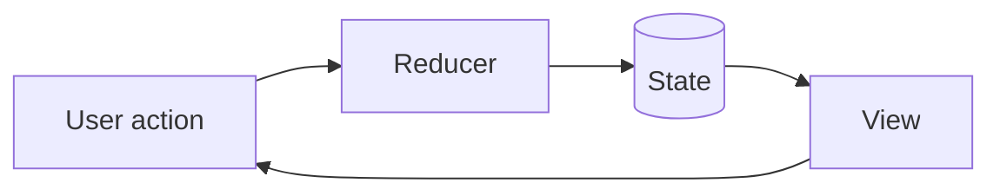

# iOS Crew #18 & RWB

Presentation as code

<div class="pt-12">
  <span class="px-2 py-1 rounded bg-white bg-opacity-10">
    Press <kbd>space</kbd> to start
  </span>
</div>

<!--
Speaker notes live in HTML comments at the end of a slide.
They show up in presenter mode (press `p` while presenting).
-->

---
transition: fade-out
---

# Agenda

<v-clicks>

- **Intro** — who we are, why we're here
- **Context** — the problem worth talking about
- **Approach** — what we tried and why
- **Results** — numbers, not vibes
- **Takeaways** — what you can steal for your own project

</v-clicks>

<!--
Each `v-click` reveals one bullet at a time.
-->

---
layout: two-cols
layoutClass: gap-8
---

# Context

The setup, in one screen.

- Where we started
- What hurt
- What we measured

::right::

# Constraints

- Time budget
- Team size
- Backwards compatibility

---

# Code

```swift {all|1-3|5-9|all}
@Observable
final class FeedModel {
    private(set) var items: [Item] = []

    func load() async throws {
        let page = try await api.feed(cursor: nil)
        items = page.items
        cursor = page.next
    }
}
```

<arrow v-click="[4, 5]" x1="400" y1="420" x2="230" y2="330" color="#953" width="2" arrowSize="1" />

<!--
The `{all|1-3|5-9|all}` after the language cycles line highlighting on each click.
-->

---

# Numbers

| Metric | Before | After | Delta |
| --- | ---: | ---: | ---: |
| Cold start | 1.20s | 0.45s | **-0.75s** |
| Feed render | 340ms | 120ms | **-220ms** |
| Binary size | 84 MB | 79 MB | **-5 MB** |

---

# Diagram



---
layout: center
class: text-center
---

# Takeaways

One idea per line. Three max.

---
layout: center
class: text-center
---

# Thanks

Ivan Oparin · iOS Crew #18 & RWB

[github.com/ivanopcode](https://github.com/ivanopcode)
